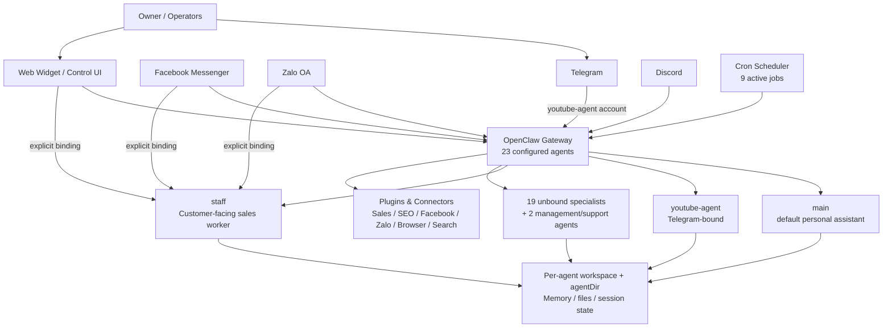
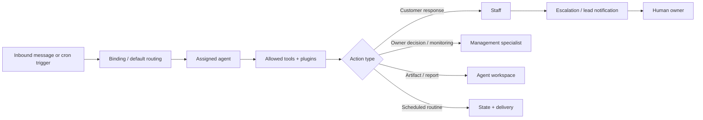

# Runtime Architecture

## Current topology (as observed)

## Explicit inbound routing

| Channel/account match | Routed agent | Role |
|---|---|---|
| Telegram account `youtube-agent` | `youtube-agent` | YouTube reporting / market content service |
| Facebook Messenger | `staff` | Customer-facing shop sales worker |
| Zalo OA | `staff` | Customer-facing shop sales worker |
| Web Widget | `staff` | Customer-facing shop sales worker |
| Default Facebook Messenger / Zalo OA / Web Widget without a more specific match | `main` is configured as default gateway agent, but current explicit `staff` bindings take precedence | Owner/default assistant |

There are no explicit inbound bindings for most named specialist agents. Their registered existence should not be confused with a live public endpoint.

## Runtime layers

### 1. Gateway and channel layer
- One local OpenClaw Gateway manages channels, agent resolution, cron, plugins, models, sessions and workspaces.
- Configured channels: Telegram, Facebook Messenger, Zalo OA, Web Widget and Discord.
- Current health check found Gateway and primary production channels reachable.

### 2. Workforce layer
- `main`: default owner assistant and general orchestrator.
- `staff`: restricted customer-facing sales worker; intentionally has a minimal tool profile.
- `sales-agent-multi-channel`: management/operations role for shop configuration, analytics, escalation, orders and automation; currently unbound inbound.
- `youtube-agent`: dedicated Telegram service with scheduled analytics and market scans.
- Remaining agents are domain specialists, management assistants, or experiments. See [agents.md](agents.md).

### 3. Capability layer
Enabled integration families include browser automation, search, OpenAI/Codex runtimes, ElevenLabs, SEO, Facebook Messenger/Pages, Zalo OA, Zalo Assist, Sales Manager and Web Widget. A connector MCP is configured but must be treated as a sensitive capability boundary; its endpoint and credential are deliberately not documented here.

### 4. State layer
Every configured agent has an isolated `workspace` path and usually an `agentDir`. In practice, isolation is organisational rather than a complete security boundary today because default filesystem/runtime policies are broad. See [security-baseline.md](security-baseline.md).

## Current operating model

## Desired target architecture

The current system should evolve from “a collection of configured agents” to an **Agent Workforce OS** with explicit layers:

1. **Ingress agents** — public-facing, sandboxed, minimum tools, strict allowlists.
2. **Domain workers** — operate a single domain and write structured artifacts.
3. **Manager/orchestrator agents** — delegate, evaluate, schedule and escalate; do not inherit public ingress trust.
4. **Private operator agents** — can access privileged data only through owner-authenticated channels.
5. **Governance layer** — agent registry, tool/data policy, action approval, audit trail, evaluation metrics and incident response.

No public ingress agent should also be the privileged manager/orchestrator.
